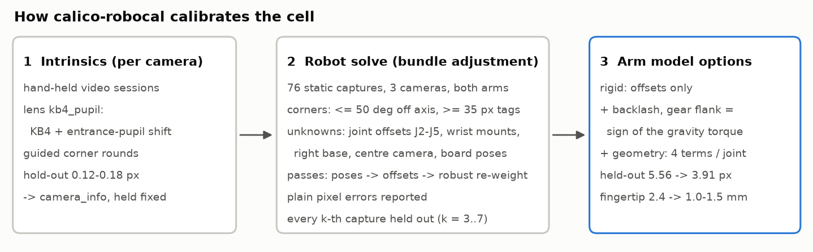
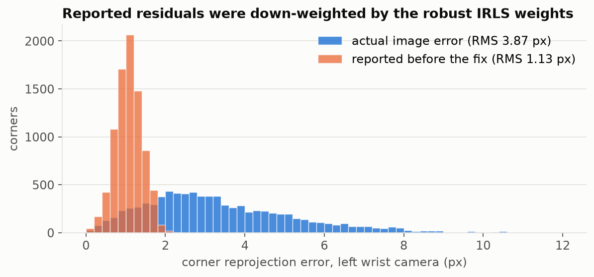
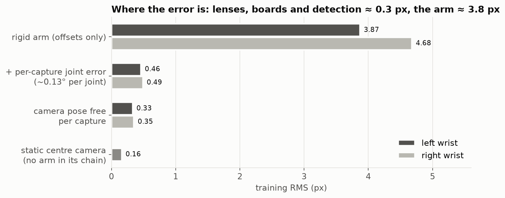
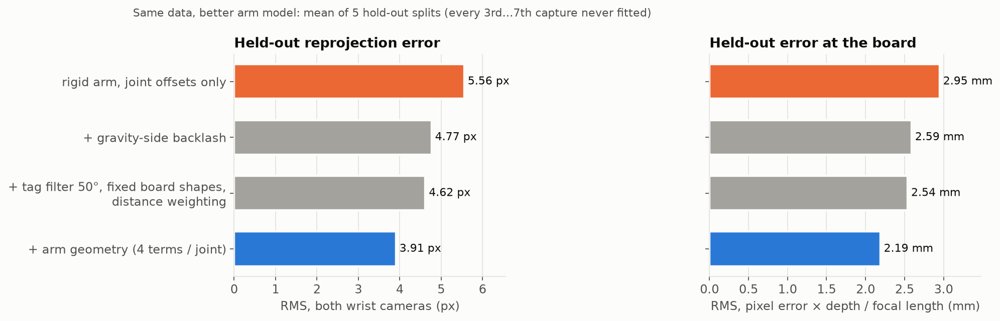
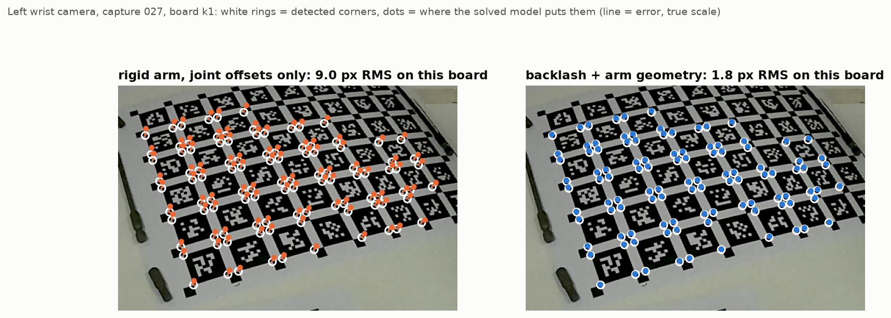
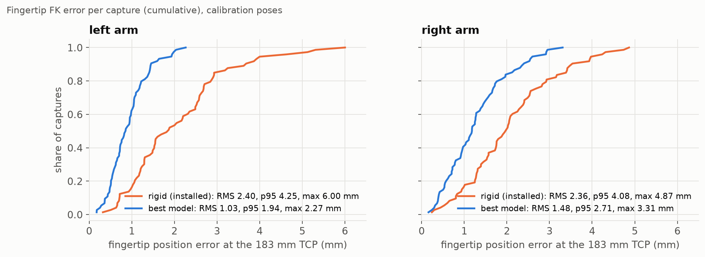
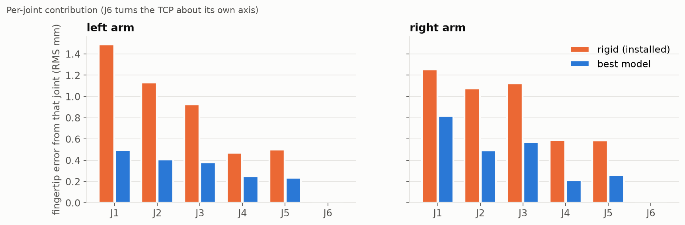
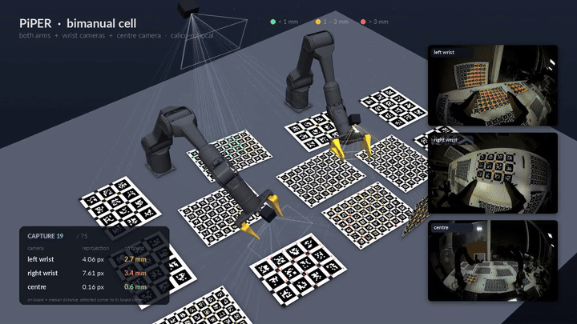
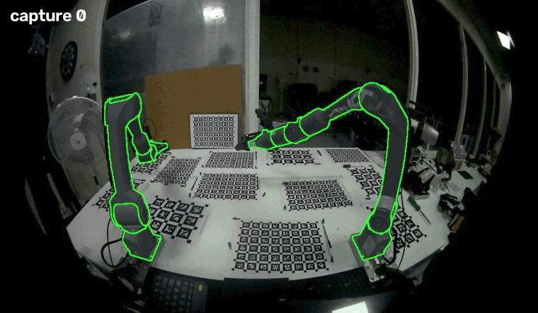

# calico-robocal on a real bimanual PiPER cell

How the joint robot + camera optimisation works, what it achieved on a real two-arm cell, where the
remaining error comes from, and what to do about it. Tool reference: `configs/robocal/README.md`.
Literature survey behind the modelling choices: [LITERATURE.md](LITERATURE.md).

## The cell and the data

- **Robot:** two AgileX PiPER arms (6 joints each, planetary quasi-direct-drive joints, motor-side
  encoders), bases about 0.65 m apart.
- **Cameras:** one 200° fisheye on each wrist (on `link6`) and one static centre camera; AR0234,
  1920 x 1200, linear (gamma 1.0) stream.
- **Targets:** 13 static Kalibr AprilGrids printed on paper and laid on the table: seven 6 x 8 with
  24 mm tags and six 3 x 4 with 45 mm tags, disjoint id blocks.
- **Captures (`fullbody_01`):** 76 static poses. Each arm was moved by hand in teach mode, left under
  gravity compensation until still, then all three cameras and both arms' joints were saved.
  A second left-arm session (`left_teach_02`, 31 poses) is used for cross-session checks.

## How the optimisation works

**Stage 1, intrinsics (per camera, off the robot).** Lens model `kb4_pupil`: Kannala-Brandt
k1..k4 plus an entrance pupil that slides along the axis with the field angle,
z0(θ) = e1 (θ / 90°)², a non-central model that wide M12 lenses need (e1 = 1.16 mm left,
1.24 mm right). Hand-held video sessions, one free pose per board view, guided corner rounds,
hold-out frames and repeatability splits. Results: hold-out 0.177 px (left), 0.127 px (right),
0.118 px (centre). The wrist files fail the strict split-repeatability gates and the centre file
fails its curve gates, so all three are provisional; the checks below show they are not what limits
the robot solve.

**Stage 2, the robot solve (intrinsics fixed).** One Ceres bundle adjustment over every corner seen
by every camera:

| Unknown | Per | Notes |
|---|---|---|
| joint zero offsets Δq | joint | J2-J5 free; J1 and J6 held at 0 (they are indistinguishable from the base yaw and the camera roll) |
| wrist camera mount | arm | `link6` -> camera optical frame |
| right arm base | arm | the left base is the world frame |
| centre camera pose | camera | static |
| board poses + shapes | board | bow and twist per sheet |
| *optional:* backlash / compliance | joint | `drive:` gear flank from the sign of the gravity torque, inertial URDF |
| *optional:* geometry | joint | 2 axis tilts + 2 shifts perpendicular to the axis, tolerance priors |

The forward model per corner is: encoder angles + offsets (+ backlash) -> URDF chain (+ geometry
terms) -> wrist camera mount -> `kb4_pupil` projection. Only reliable tags are used: at least 35 px
across and within 40° of the optical axis (50° in the best model) (`detection.min_tag_px`,
`max_theta_deg`).

Solve passes: (1) poses with offsets held; (2) offsets free, per-corner robust (IRLS Huber)
weights; outlier rejection on the plain image error; pixel-noise estimate; (3) re-weighted solve.
Every model below is judged on **held-out captures**: every k-th capture is left out of the fit and
predicted with the solved parameters, for k = 3...7 (five different splits), and the mean is reported.

## What changed (and why the early numbers were wrong)

The first reports of this solve said 1.13 / 1.21 px at the wrists. They came from residuals that
already carried the solver's robust IRLS weights, so a 12 px corner was reported as about 2 px. The
fix reports the plain image error everywhere (RMS, percentiles, `residuals.csv`, outlier test,
sanity gate). The calibration values hardly moved (offsets <= 0.015°, mounts <= 0.1 mm); the
accuracy statement did: 3.87 / 4.68 px.

## Where the error is

Giving the arm more freedom per capture shows which part of the model is missing. The lenses,
boards and corner detection account for about 0.3 px; the arm accounts for about 3.8 px. Freeing
the lenses inside the robot solve changes the error by < 0.1 px.

Each capture's true joint angles differ from the encoder readings by 0.1-0.15° per joint, spread
over all joints. In teach mode under gravity compensation the motors only cancel the weight and
friction holds the arm, so the gears rest wherever the hand left them within their play. The
encoders sit on the motor side and do not see it. Heavily loaded joints (J2, J3) are pressed to one
side by gravity, and that part is predictable; the rest is not, from this data.

## Results on the same data

What that means in an image: detected corners (white rings) and where each solved model puts them, on
one board seen by the left wrist camera.

Kept, each row adding to the one above (held-out RMS, both wrist cameras, mean of 5 splits;
"mm" = pixel error x corner depth / focal length):

| Model | px | mm |
|---|---|---|
| rigid arm, joint offsets only | 5.56 | 2.95 |
| + backlash with the gear flank from the gravity torque (`drive: {approach: against_gravity}`) | 4.77 | 2.59 |
| + tag filter 50° (was 40°), board shapes held at the image-only fit, distance weighting 0.5 mm | 4.62 | 2.54 |
| **+ arm geometry, 4 terms per joint, priors 1 mm / 0.3° (`arms[].geometry`)** | **3.91** | **2.19** |

Each of the three middle changes alone: filter 4.68 px, fixed board shapes 4.69 px, distance weighting
4.77 px (neutral). Geometry priors between 0.3 mm / 0.1° and 2 mm / 0.6° give the same result.

Tried and rejected:

| Variant | px | Why |
|---|---|---|
| backlash on J2 only / J2+J4 / J2-J5 | 5.07 / 4.94 / 4.83 | all joints is better |
| backlash with the approach direction taken from consecutive captures | 5.28 | snapshots do not show how the arm entered a pose |
| tag size >= 25 / 50 px (vs 35) | 5.19 / 5.29 | 35 px is best |
| free per-capture joint error, Gaussian 0.03-0.15° | 5.38-5.93 | over-fits |
| free per-capture joint error, robust (Cauchy) | 6.91-7.33 | over-fits |
| gear flank chosen per capture (two-state) | 5.17-5.19 | over-fits |
| J1 / J6 offsets freed | no change | not observable (base yaw, camera roll) |
| lenses re-fitted inside the robot solve | < 0.1 px gain | lenses are not the limit |

Checks that the gains are not an artefact of one split or one session:

- **Cross-session** (left arm; parameters from one session held fixed in the other, only the boards
  refit): rigid 3.79 / 4.19 px, backlash 3.26 / 3.90 px.
- **Both sessions in one solve** (107 left-arm poses, separate board poses per session): left
  held-out 5.59 px rigid, 4.14 px backlash, **3.25 px backlash + geometry** (better in 5 of 5 splits).
- **Leave-one-capture-out** spread of the J2-J5 offsets (backlash model): left
  0.21 / 0.13 / 0.06 / 0.05°, right 0.35 / 0.18 / 0.08 / 0.06°.

Best model on all captures: training RMS 2.56 px (left wrist), 3.52 px (right), 0.16 px (centre);
geometry terms <= 0.37° tilt and <= 1.5 mm shift per joint.

## Fingertip accuracy

Each capture's remaining joint error (from an errors-in-variables fit, i.e. the joint angles the
cameras actually see) pushed through the PiPER URDF to the tool centre point 183 mm from `link6`:

| Model | left RMS / p95 / max (mm) | right RMS / p95 / max (mm) |
|---|---|---|
| rigid, offsets only | 2.40 / 4.25 / 6.00 | 2.36 / 4.08 / 4.87 |
| best model (backlash + geometry + filter + boards) | 1.03 / 1.94 / 2.27 | 1.48 / 2.71 / 3.31 |

These are on the calibration poses; new poses will be somewhat worse (the held-out improvement at
the board is 26 %). J1 and J2 dominate because they are furthest from the tool. The gripper geometry
itself comes from the URDF and is not calibrated.

To use the best model, the forward kinematics on the robot must apply the same terms: the geometry
terms (as in `UrdfChain::Forward`) and the backlash term h_j (s_j - s_ref_j) with s_j the sign of the
gravity torque on joint j. An offsets-only FK should keep the rigid offsets.

## Other findings

- **Board sheets:** printed paper lying on the table is flat to <= 0.8 mm bow, 0.1-0.25 mm local
  waviness, and every sheet is 0.47 % shorter in y than in x (the printer). Together about
  0.1-0.15 px; rigid boards or a measured `print_scale_pct` remove it.
- **No encoder clamping:** no repeated readings at the joint range ends; the arm was still during
  every capture (joint spread 0.000° in 73 of 76 captures, max 0.11°).

## Visualisations

**The calibrated cell, capture by capture**: PiPER meshes, boards, camera rays, each camera's
reprojection error, and how far the back-projected corners land from their boards (green < 1 mm,
yellow 1-3 mm, red > 3 mm). Full video: [system_calibration_piper.mp4](media/system_calibration_piper.mp4).

**The calibrated robot model drawn through the real centre-camera lens** (green outlines) over the
captures (brightened for display). Full video with all three cameras:
[toolkit_overlay.mp4](media/toolkit_overlay.mp4).

The same per-capture view as a 3D plot next to the three camera images:
[system_calibration_fast.mp4](media/system_calibration_fast.mp4).

The animations and videos show the offsets-only calibration with the corrected (plain) error figures.

## Next capture: what to change

The remaining error is mostly how the data was collected, not the solver:

1. **Drive the arms under position control**, not teach mode; record waypoints by hand if
   convenient, then replay them.
2. **End every move in a fixed direction per joint** (e.g. a 3° overshoot and return, J2 / J3
   against gravity) so the gear flank is known, and **log the motor current at rest**: on a
   quasi-direct drive its sign is the gear-torque sign.
3. **Settle at least 2 s, then capture**; log commanded and measured angles.
4. **Repeat about 10 poses from both directions** to measure the gear play and the true
   repeatability before modelling further.
5. **More poses** (150-300 per arm) in at least 3 sessions; validate on a held-out session.
6. **Rigid boards**, or measure the printed sheets.

Scripts used for the experiments, figures and videos live with the data, not in this repository;
every number above can be reproduced with the options documented in `configs/robocal/README.md`.
